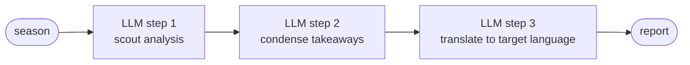
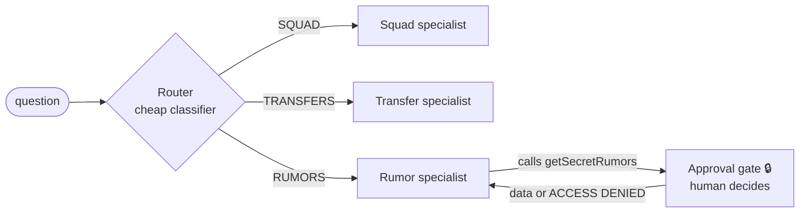
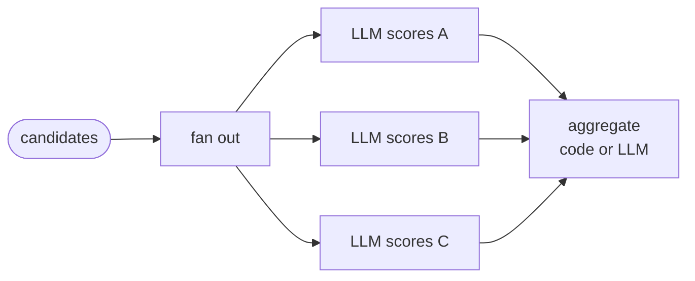
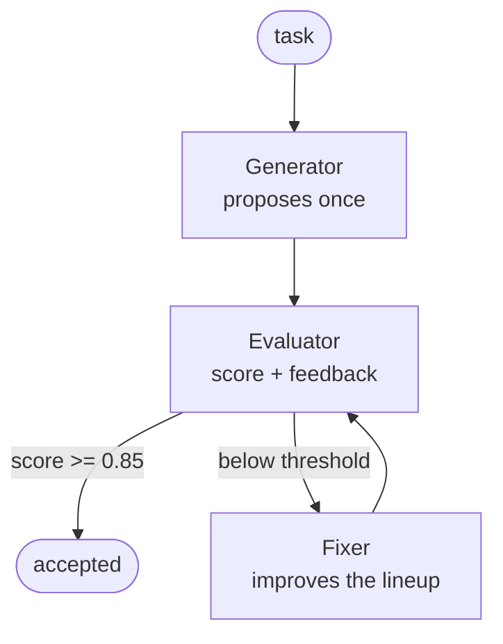
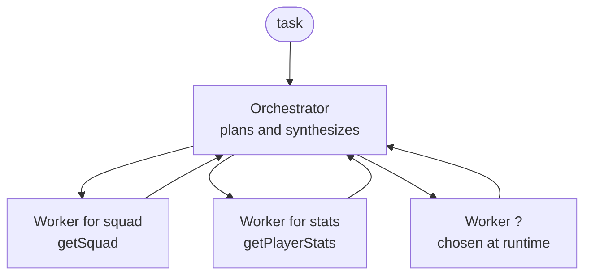

# Agentic Workflow Patterns

Two mirror modules implement the five canonical workflow patterns from
Anthropic's *Building Effective Agents*. They share the same endpoints and the
same AC Milan domain, with a different framework underneath.

| Module | Port | Style |
|--------|------|-------|
| `patterns-langchain4j` | 8087 | Agentic DSL **where it pays off** (`sequenceBuilder`, `conditionalBuilder`, `loopBuilder`), plain Java where it does not |
| `patterns-spring-ai`   | 8088 | Explicit, with ChatClient + plain Java (loops, switch, CompletableFuture) |

**Three of the five use the DSL, two deliberately do not.** That is a result,
not an omission. The DSL earns its place where a pattern has *state and a
condition* (chaining, routing, the evaluator loop) and earns nothing where a
pattern only has *concurrency* (parallelization), because there
`CompletableFuture` does the same job and hides less. Orchestrator workers
skips `supervisorBuilder()` for a different reason, explained below. The plan
should be a typed value you can log.

One class per pattern, named after the pattern. Agents are Spring beans,
built once in the constructor and injected where needed. Shared domain data
lives in `common` (`MilanKnowledgeBase`), and each module exposes it through
its own tool annotations (`@Tool`/`@P` in LC4j, `@Tool`/`@ToolParam` in Spring
AI). The tools are `getSquad(year)`, `getPlayerStats(name)`,
`getTransfers(window)` and `getSecretRumors()` 🔒. The last one is gated by
human approval (`common/approval`, decided at
`http://localhost:3000/approvals`).

**Endpoints, identical on both ports**

| Pattern | Endpoint | Example |
|---------|----------|---------|
| 1. Prompt chaining | `GET /api/v1/patterns/chain?season=&language=` | `?season=2007&language=Polish` |
| 2. Routing | `POST /api/v1/patterns/routing` | body `"Show me the latest transfer rumors."` |
| 3. Parallelization | `GET /api/v1/patterns/parallel` | none |
| 4. Evaluator optimizer | `GET /api/v1/patterns/evaluator?season=` | `?season=2007` |
| 5. Orchestrator workers | `POST /api/v1/patterns/orchestrator` | body `"compare the 2007 and 2024 squads"` |

The Chat UI has a **Patterns Lab** page (`http://localhost:3000/patterns`)
that runs each pattern against BOTH modules at once and shows the answers side
by side with execution times, next to a diagram of the flow. Each result panel
labels what the implementation actually is, per pattern, instead of a blanket
"Agentic DSL" that would be true for three of them and false for two.

The rule of thumb from Anthropic is to **use the simplest pattern that
works**. Escalate chain → routing → parallel → evaluator → orchestrator only
when the previous one is not enough. Full autonomy is the last resort.

***

## 1. Prompt chaining (sequence)

Output of step N feeds step N+1. The decomposition is designed by YOU,
not the model. Each step can use its own prompt, model and validation.

* **LC4j** uses `AgenticServices.sequenceBuilder().subAgents(scout, condenser, translator)`
  with shared state via `outputKey`. The language enters the state as
  `@V("language")`.
* **Spring AI** makes three consecutive `chatClient.prompt()...call()` calls.
  There is no workflow API, the pattern *is* the code.
* **Where the DSL pays.** Without it you thread the result of step N into step
  N+1 by hand, and the language has to be carried through three methods. With
  `outputKey` the state is named and flows on its own.
* **Language switch.** `language` accepts any of English (default), Polish,
  Romanian, Hindi, Dutch, Greek and Turkish, or `Mixed`, which
  `TranslationLanguages.resolve()` turns into an instruction to blend **all**
  of them in one text. Nothing in the workflow changes, only the string
  injected into the last link. That is the pattern's whole point. Links are
  independent, so you can swap one without touching the others.
* **Trace signature.** A staircase of sequential `chat` spans, each starting
  when the previous ends.

## 2. Routing

A cheap classifier picks the specialist. Separation of concerns means each
specialist has its own prompt, and the router only needs to recognize, not
answer.

* **LC4j** is the Agentic DSL end to end, with `conditionalBuilder()` and
  predicates over shared state, composed by `sequenceBuilder()`. The router
  writes a route into the state and each branch declares the predicate that
  selects it. There is no `switch` anywhere.
* **Spring AI** makes one cheap call with structured output, then a `switch`
  on the enum. Note that a *bare* enum (`.entity(Route.class)`) is fragile,
  because models wrap the value in quotes or JSON and the converter throws.
  Wrapping it in a record (`RouteChoice`) gives the converter a proper schema,
  and a fallback that parses a string keeps the router alive either way.
* **Where the DSL pays.** Routing is a decision over shared state, which is
  exactly what `conditionalBuilder` expresses. Rewriting it from the original
  `switch` cost nothing in latency and kept the `toolProvider`, so tool spans
  and the approval gate still work, which was the only real risk.
* **Approval gate order.** The gate sits **after** the specialist, not before
  it. The specialist decides the secret tool is needed. Only then does
  `getSecretRumors()` block on human approval and return the data or
  `ACCESS DENIED`, which the model relays to the user as a refusal.
* **Tools are shared, for now.** Every specialist gets all four tools (one
  `milanAgent` in Spring AI, the same `milanToolProvider` for all three
  specialists in LC4j), so the squad specialist could call `getSecretRumors()`
  and trigger the gate. Giving each specialist only its own tools is the
  obvious next step, and routing is the natural place for least privilege.
* **Prompt lesson.** A specialist prompt must *command*, not suggest.
  "Use getSecretRumors" made the model answer *"Yes, I can check that, would
  you like me to?"* and the gate never fired. The prompt now forbids offers
  explicitly and states that calling the gated tool **is** the way to ask for
  permission.
* **Trace signature.** One SHORT `chat` (router) + one LONG `chat`
  (specialist).

## 3. Parallelization

Independent subtasks run concurrently, and code (or a final LLM call)
aggregates. There are two flavours, *sectioning* (different work per branch)
and *voting* (same task N times, take the median).

* **Both modules use plain `CompletableFuture`** around AiServices / ChatClient
  scorers, on purpose, because the DSL adds nothing to a fan out. The fan out
  is the same on both sides and the error handling is not (see below), so the
  timings side by side compare slightly different work.
* **Trace signature.** OVERLAPPING `chat` spans with a common start. It is the
  only pattern where the waterfall stops being a staircase.
* **Structured output is best effort.** `gpt-4o-mini` occasionally returns a
  partial object. The Spring AI branch retries once with a blunter prompt and,
  failing that, records 0.0 with an explicit rationale rather than silently
  ranking the wrong candidate. A branch that throws (timeout, 429) is caught
  per branch, because `join()` would otherwise turn one failed candidate out of
  five into a 500 for the whole request. The LangChain4j twin has neither. Its
  `CandidateScore` holds a primitive `double` and it calls `join()` directly,
  so there one failed branch still fails the request.
* **Practical note.** This pattern is why we migrated to OpenRouter. A local
  Ollama on a single GPU or CPU serializes inference and hides the parallelism.

## 4. Evaluator optimizer (loop)

A generator produces a solution **once**. An evaluator scores it against
explicit criteria and returns feedback. A fixer improves the SAME solution
until the score passes a threshold or the iterations run out. The only
workflow pattern with a cycle.

* **LC4j** uses `loopBuilder().subAgents(scorer, fixer).maxIterations(4).exitCondition(scope -> scope.readState("evaluation", new Evaluation(0.0, "")).score() >= 0.85)`
  and the scorer writes the same `Evaluation(score, feedback)` record that
  Spring AI uses.
* **Spring AI** uses a handwritten `for` with an evaluator that returns
  structured output (`record Evaluation(double score, String feedback)`) and an
  `if` on the threshold. It is the sharpest contrast between DSL and Java in
  the whole set, an exit *condition* versus a place in the control flow.
* **The two modules ran different algorithms for a while.** Spring AI
  regenerated the lineup from scratch on every lap while LangChain4j proposed
  once and only fixed. It was the same label over different work, which made
  the timings side by side meaningless (18.6 s versus 6.4 s). They now match.
  The handwritten loop stays, because *that* is the contrast worth showing,
  not the algorithm inside it.
* **The evaluator was scoring blind.** It was asked to check "uses only listed
  players" while the squad list went to the generator only. The result was an
  unverifiable criterion, defensive scoring, a threshold never reached and
  four iterations every time. It was visible as a permanent "Best effort after
  4 iterations" and, in the metrics, as roughly twice the calls and tokens of
  the twin.
* **0.85 is a demo parameter, not a quality bar.** It sits deliberately in the
  gap between what the scoring rules grant a correct lineup (0.8) and what they
  grant one that also lists shirt numbers and states the formation (0.9), so a
  lineup that is merely correct fails and the fixer has to add exactly those
  two things. A first proposal that already has both passes on the first check,
  and that happens often, because the generator gets the squad with shirt
  numbers, so a run that should show the loop may need a second try. At 0.8
  every correct first lineup would pass and the pattern would demonstrate
  nothing. The value lives in **three** places, both `THRESHOLD` constants and
  the flow diagram in `chat-ui`.
* **Trace signature.** One `chat` (generator), then N repetitions of a
  score+fix pair. The Spring AI side wraps each lap in an
  `evaluator_iteration N` span carrying `evaluator.score`, so the waterfall
  shows quality converging. The LangChain4j side has no such span, because the
  loop lives inside `loopBuilder()`. It could, because an `AgentListener` on
  the scorer sees every call and its `Evaluation`, and `AgentMonitor` already
  numbers the laps (`iterationIndex`). It takes extra wiring, while a
  handwritten loop owns its counter. It is the same trade as always, one level
  down.

## 5. Orchestrator workers

A central LLM PLANS AT RUNTIME. It decomposes the task into subtasks that
couldn't be hardcoded, delegates to workers and synthesizes. Versus
parallelization, there you wrote the branches and here the orchestrator
invents them per request.

* **LC4j** runs the same three phases as Spring AI. A `Planner` AiService with
  structured output (a `Plan` record) → one `Worker` call per subtask, tools
  attached → a `Synthesizer` call, with the same prompts on both sides. An
  earlier version was one AiServices agent with tools, which is an agent, not
  orchestrator workers. `supervisorBuilder()` would let a supervisor LLM pick
  the next subagent turn by turn, with no upfront plan to log.
* **Spring AI** is an explicit pipeline. Planner call with structured output
  (a `Plan` record) → one worker call per subtask → synthesis call.
* **The timings are comparable.** Both modules run planner → workers →
  synthesis with the same prompts. The number of worker calls still varies
  per run, because the plan does.
* **Trace signature.** A plan `chat`, one worker `chat` per subtask with its
  tool spans, then a final `chat`. How many workers run is decided at
  runtime, so every run may produce a different shape.

***

## Gotchas

* **Agent interfaces in the Agentic DSL must be `public`.** The runtime calls
  them reflectively from another package (`AgentInvoker` → `Method.invoke`)
  without `setAccessible()`, so a nested interface with package visibility
  fails with `IllegalAccessException: ... cannot access a member ... with
  modifiers "public abstract"`. It is confusing, because the *method* is
  public. What matters is the visibility of the declaring interface. Plain
  `AiServices` is unaffected (it goes through a proxy).
* **`-parameters` compiler flag.** `spring-boot-starter-parent` sets it for
  you. A custom parent must do it explicitly, otherwise `@RequestParam` without
  an explicit name fails at runtime ("Name for argument of type [int] not
  specified"). Both controllers name their parameters explicitly anyway.
* **An asymmetric prompt makes a comparison meaningless.** Two of the five
  patterns quietly drifted apart (the evaluator by algorithm, parallelization
  by prompt wording), and in both cases the timings side by side kept looking
  authoritative. When the point of a module is comparison, the prompts are part
  of the contract, not an implementation detail.

## Across all patterns

* **Autonomous agent** (the model decides everything in a loop) is the
  baseline implemented three times elsewhere in this repo (`raw-agent`,
  AiServices, ChatClient). The patterns above exist precisely so you *don't*
  need it for every problem. `multimodal-lab` is the fourth variant and the
  most extreme, with five tools, no plan of ours at all, and the loop owned
  entirely by `ToolCallingAdvisor`.
* **Who owns the loop is the real question.** In `patterns-spring-ai` we write
  it, so `MAX_ITERATIONS` is on the first line. In `multimodal-lab` the
  framework writes it. On Spring AI 2.0.0 there was no iteration limit at all,
  and a failing tool was once called over a hundred times in one turn. Since
  2.0.1 the framework caps a turn at 40 calls per tool and 150 in total, but
  that counts calls, not failures. Delegating the loop means the stop condition
  becomes your job in a place where nothing reminds you of it.
* **Human in the loop** is not a flow pattern but a gate spliced into one.
  Here it guards `getSecretRumors()` in both modules via the shared
  `HumanApprovalService.gate(...)` from `common`, with the same REST contract
  and UI as `mcp-server`. The guarded work is passed as a lambda, so a tool
  *cannot* execute it without a decision.
* **Observability.** All five patterns inherit tracing + GenAI metrics from
  `common`. Recognizing a pattern by its Tempo waterfall is the best single
  demo in the series.
